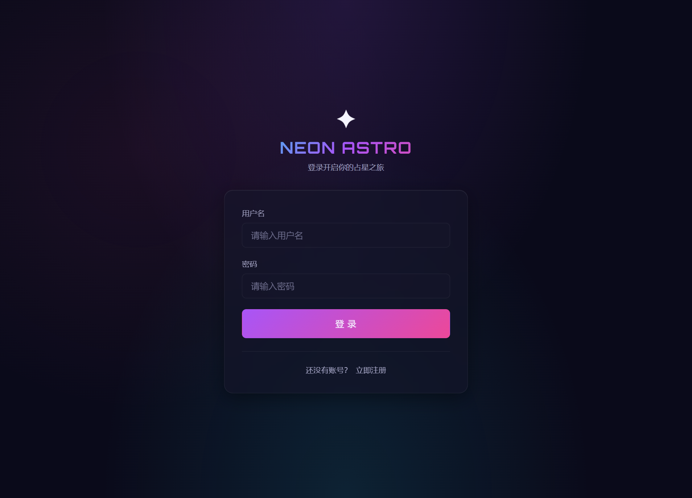
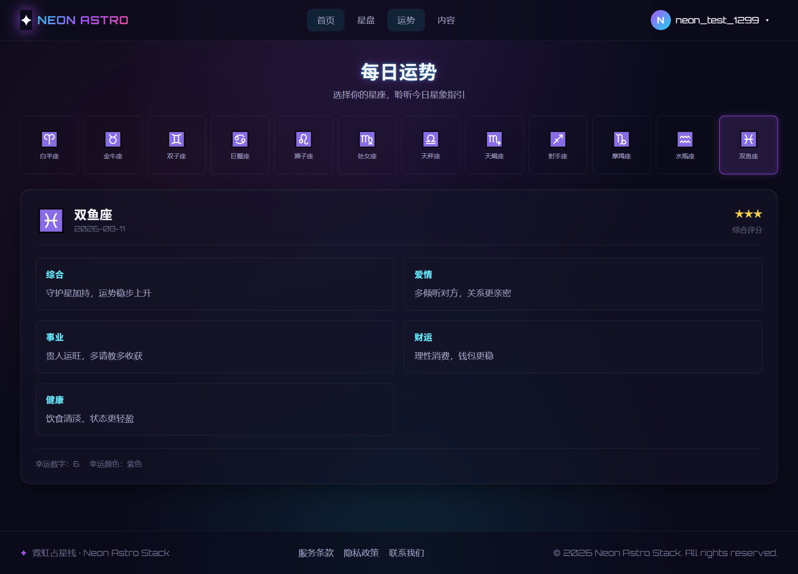
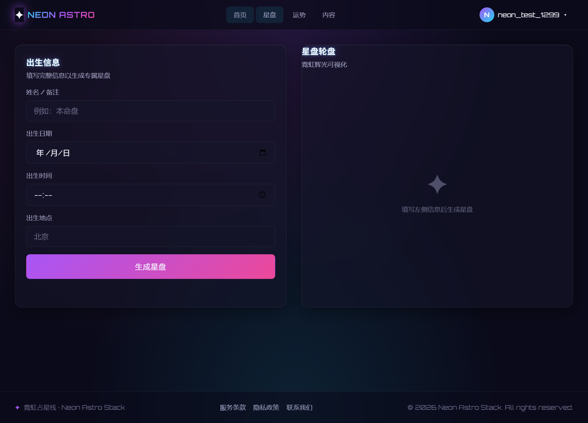
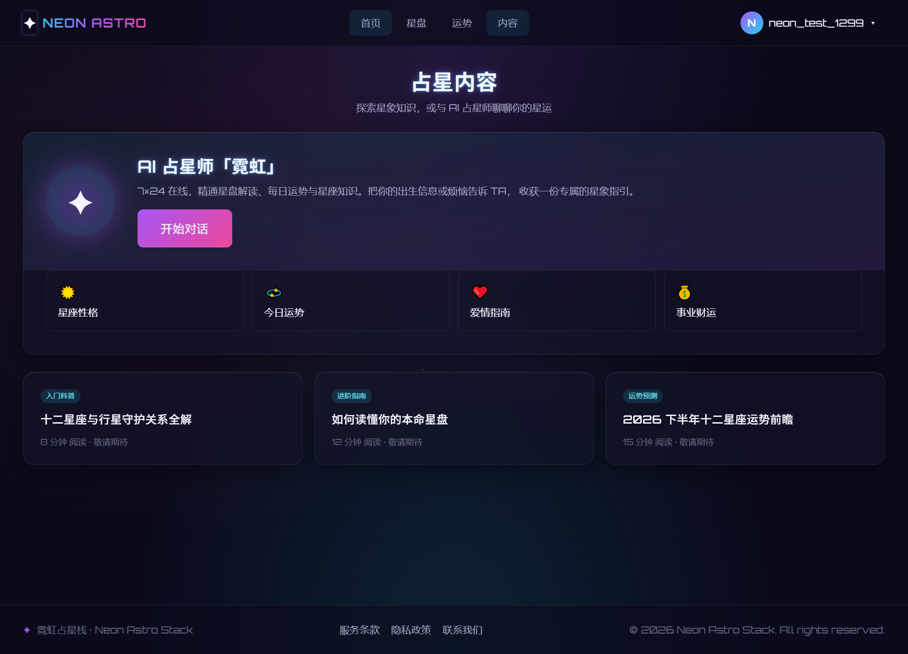
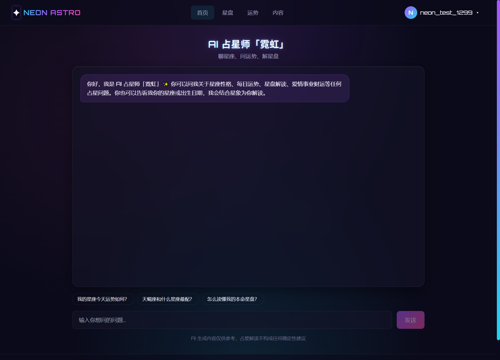
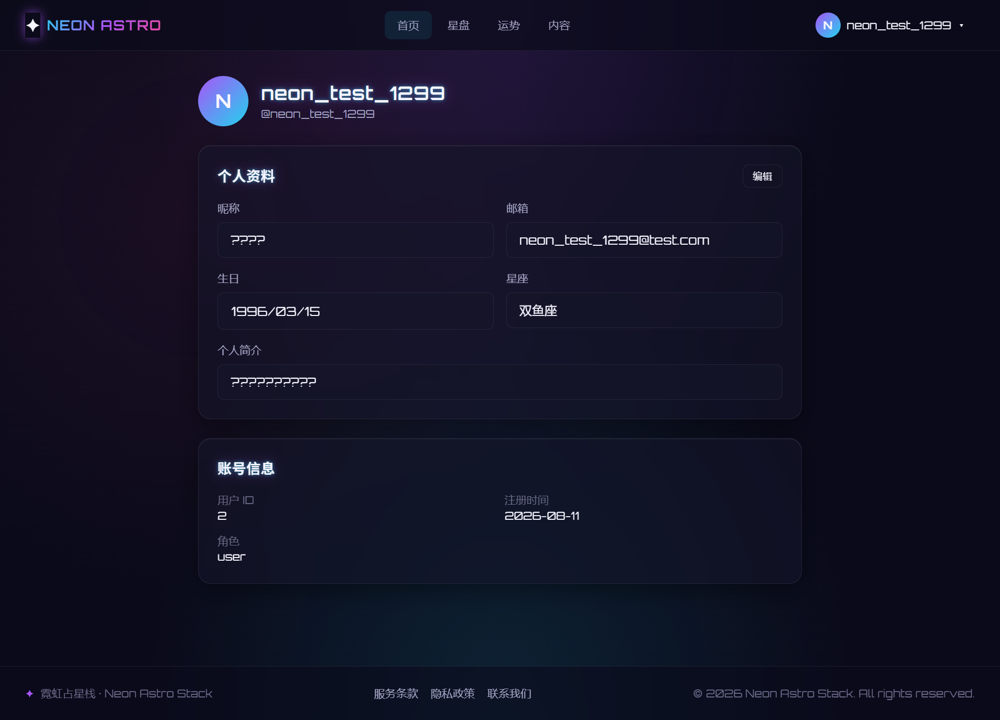
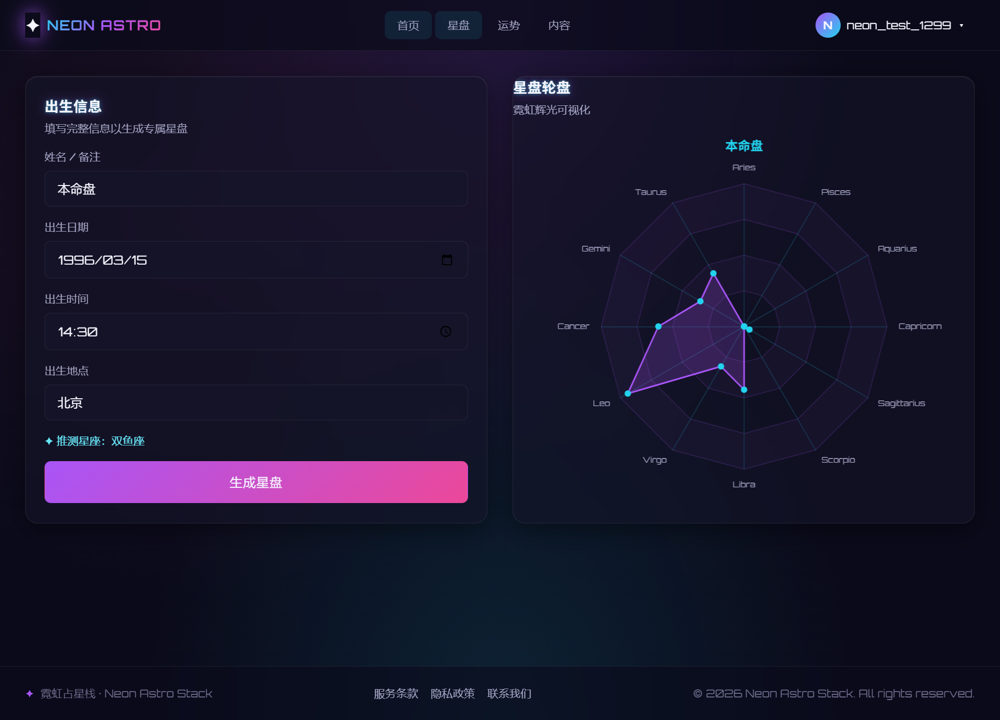

# Neon-Astro-Stack

霓虹占星栈 —— 一个以霓虹视觉美学（暗黑背景 + 辉光动效）为核心的占星服务平台。

- 🔐 账号体系：JWT 双 Token 认证（访问令牌 2h / 刷新令牌 7d 自动续期）
- ✦ 星盘生成：基于出生信息计算本命盘，ECharts 霓虹轮盘可视化
- ☽ 每日运势：十二星座每日/每周运势，首次生成自动落库
- 🤖 AI 占星师：对接自定义大模型（OpenAI 兼容接口），星座占星专属人设
- 🌌 个人中心：资料编辑、生日星座自动识别

## 功能截图

| 登录页 | 首页（我的星座速览） |
|:---:|:---:|
|  |  |

| 每日运势 | 星盘生成 |
|:---:|:---:|
|  |  |

| 占星内容 | AI 占星师对话 |
|:---:|:---:|
|  |  |

| 个人中心 | 星盘轮盘（生成结果） |
|:---:|:---:|
|  |  |

## 功能大纲

### 用户与认证（auth / user）
- 注册、登录、登出、刷新令牌（双 Token + 黑名单，Redis/内存存储可切换）
- 个人资料查看与编辑：昵称、邮箱（唯一校验）、生日、简介
- 生日自动识别星座（前端实时提示 + 后端权威计算）

### 星盘（chart）
- 出生信息（姓名/日期/时间/地点）生成本命盘
- 确定性星盘计算引擎：10 颗行星的星座落点 / 度数 / 宫位 / 逆行
- 上升星座（ASC）与天顶（MC）自动计算
- ECharts 霓虹轮盘可视化 + 生成记录分页查询

### 运势（horoscope）
- 每日运势：综合 / 爱情 / 事业 / 财运 / 健康五维解读 + 幸运色 / 幸运数字 / 星级评分
- 每周运势：本周概述 + 三条亮点
- 公开接口（游客可看），首页与运势页默认展示**当前登录用户的星座**

### AI 占星师（ai）
- OpenAI 兼容接口（base-url / api-key / model 全配置化，密钥环境变量注入）
- 专属占星师人设系统提示词 + 动态注入当前日期（Asia/Shanghai）保证运势解读准确
- 前端对话页：会话上下文客户端维护、Markdown 富文本渲染（marked + DOMPurify 防 XSS）

### 部署与工程化
- Flyway 数据库版本迁移（V1 建表 / V2 chart_data 类型调整）
- docker-compose 全栈编排（PostgreSQL + Redis + 后端 + 前端 Nginx）
- Actuator 健康检查 + Prometheus 指标、SpringDoc OpenAPI 接口文档
- 全局异常处理（统一 Result 响应 / 404 正确语义 / 参数校验）

## 技术栈

| 端 | 技术 |
|----|------|
| 前端 | Vue 3 (Composition API) + TypeScript + Vite + Pinia + Vue Router + TailwindCSS + Axios + ECharts |
| 后端 | Java 17 / 21 + Spring Boot 3 + Spring Security 6 + JWT + MyBatis-Plus + PostgreSQL + Redis + Flyway |
| 部署 | Docker + Nginx + Actuator + Prometheus |

## 项目结构

```
Neon-Astro-Stack/
├── backend/          # Spring Boot 后端（模块化单体）
│   └── src/main/java/com/neonastro/
│       ├── common/        # 统一响应 / 异常 / 工具
│       ├── config/        # Security / MyBatis-Plus / Redis / OpenAPI
│       ├── security/      # JWT 过滤器 / Token 存储抽象
│       └── modules/       # 业务模块（auth / user / chart / horoscope / ai / content / order / admin）
├── frontend/         # Vue 3 前端
│   └── src/
│       ├── api/           # Axios 封装 + 模块 API（自动刷新 Token）
│       ├── components/    # Neon 通用组件 / 布局 / 星盘组件
│       ├── composables/   # useAuth / useTheme / useToast
│       ├── router/        # 路由 + 守卫
│       ├── stores/        # Pinia（auth / user / theme）
│       ├── styles/        # Tailwind + 霓虹主题
│       ├── types/         # TS 类型定义
│       ├── utils/         # ECharts / 格式化 / 存储
│       └── views/         # 页面
├── docker/           # docker-compose 编排
├── docs/screenshots/ # 功能页面截图
└── .env.example      # 环境变量模板
```

## 快速开始

### 1. 启动基础设施（PostgreSQL + Redis）

```bash
cd docker
docker compose -f docker-compose.dev.yml up -d
```

### 2. 启动后端

```bash
cd backend
mvn spring-boot:run
# 默认端口 8080，context-path /api/v1
# 说明：dev 环境默认 neon.redis.enabled=false（内存存储，无需 Redis 即可运行）
```

### 3. 启动前端

```bash
cd frontend
npm install
npm run dev
# 默认端口 5173，自动代理 /api -> localhost:8080
```

### 4. 配置 AI 占星师（可选）

设置环境变量（或修改 `backend/src/main/resources/application-dev.yml` 的 `neon.ai.*`）：

```bash
export AI_BASE_URL=https://api.deepseek.com   # 你的 OpenAI 兼容接口地址
export AI_API_KEY=sk-xxx                      # 你的 API Key（勿提交到仓库）
export AI_MODEL=deepseek-chat                 # 模型名
```

### 5. 全栈 Docker 部署

```bash
cp .env.example .env   # 按需修改（含 AI_BASE_URL / AI_API_KEY / AI_MODEL）
cd docker
docker compose up -d --build
# 前端 http://localhost  后端 http://localhost:8080
```

## 默认账号

数据库初始化后通过注册接口创建首个用户，或参考 `backend/src/main/resources/db/migration/V1__init_schema.sql`。
